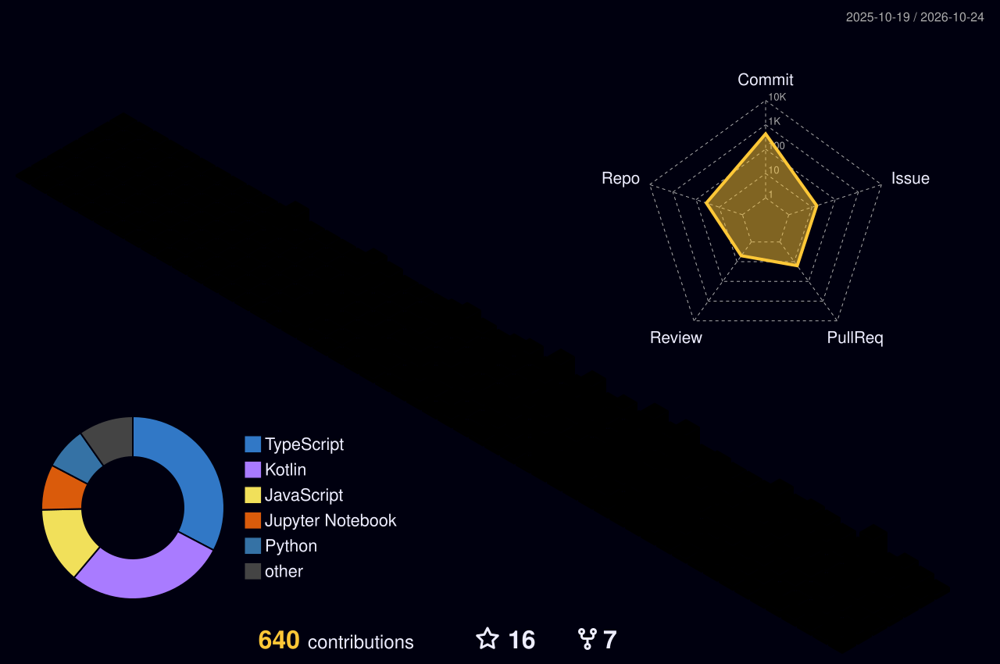

# Hi, I'm Komal

### Software Engineer · Android & Backend Developer

I'm a CS undergrad building **Android and backend applications** with a focus on
**clean architecture, scalable systems, APIs, and real-world problem solving**.
   
I enjoy understanding **how systems work**, not just making them work.

---
## ⚡ Tech Arsenal

<!-- ==================== LANGUAGES ==================== -->

<table align="center">
<tr>
<td align="center" width="650">

<h3>💻 Languages</h3>

Java
&nbsp;&nbsp;

Kotlin
&nbsp;&nbsp;

Python
&nbsp;&nbsp;

TypeScript
&nbsp;&nbsp;

JavaScript

</td>
</tr>
</table>

 

<!-- ==================== ANDROID + BACKEND ==================== -->

<table align="center">
<tr>

<td align="center" width="400">

<h3>📱 Android Development</h3>

Kotlin
&nbsp;&nbsp;

Firebase
&nbsp;&nbsp;
📦 Jetpack Compose

</td>

<td align="center" width="400">

<h3>⚙️ Backend & Database</h3>

Node.js
&nbsp;&nbsp;

Express.js
&nbsp;&nbsp;

PostgreSQL

</td>

</tr>
</table>

 

<!-- ==================== AI & ML ==================== -->

<table align="center">
<tr>
<td align="center" width="650">

<h3>🤖 AI & Machine Learning</h3>

Python
&nbsp;&nbsp;

TensorFlow
&nbsp;&nbsp;

Pandas
&nbsp;&nbsp;

NumPy
&nbsp;&nbsp;
🧠 Computer Vision
&nbsp;&nbsp;
🔤 NLP

</td>
</tr>
</table>

 

<!-- ==================== TOOLS ==================== -->

<table align="center">
<tr>
<td align="center" width="650">

<h3>🛠️ Tools & Platforms</h3>

Git
&nbsp;&nbsp;

GitHub
&nbsp;&nbsp;

Linux
&nbsp;&nbsp;

Postman
&nbsp;&nbsp;

Render

</td>
</tr>
</table>

## 🚀 Featured Projects

*Building developer tools that prevent problems, apps that simplify workflows, and AI systems that turn complexity into clarity.*

### 🛡️ [API Contract Guardian](https://github.com/komallsingh/api-contract-guardian)
Catch breaking API changes and trace potential consumer impact — right inside VS Code.

### ⚡ [Broadcast Server](https://github.com/komallsingh/Broadcast-server)
A WebSocket-powered broadcasting server with CLI controls and graceful connection management.

### 🔗 [shorTea App](https://github.com/komallsingh/shortTea-App)
A Bitly-inspired Android app that brings link shortening, QR codes, and smart analytics into one place.

### ⚙️ [shorTea Backend](https://github.com/komallsingh/shorTea)
A production-focused URL shortening backend built for secure redirects, scalable APIs, and actionable click analytics.

### 📱 [CodeBell](https://github.com/komallsingh/CodeBell)
Never miss a coding contest — track competitions across platforms and keep your programming schedule in sync.

### 🩺 [MediScan](https://github.com/komallsingh/MediScan)
Turn complex medical reports into clearer, easier-to-understand health insights with AI-powered analysis.

### 🤖 [AIVA](https://github.com/komallsingh/AIVA)
An AI-powered assistant combining computer vision and voice analysis for emotion-aware, context-sensitive interactions.

 ---
## 🎯 Currently

- 📱 Building scalable Android applications using **Kotlin, Jetpack Compose, and clean architecture**
- ⚙️ Designing backend systems with **APIs, databases, security, and cloud deployment**
- 🏗️ Exploring **System Design, distributed systems, and scalable architectures**
- 🤖 Exploring **Generative AI and machine learning applications**

---

  

---

  <b>Open to internship and career opportunities.</b>

  Continuously getting humbled by DSA problems, learning from failures,
  and improving one algorithm at a time.

  <i>It's never too late to start again.</i> ✨

